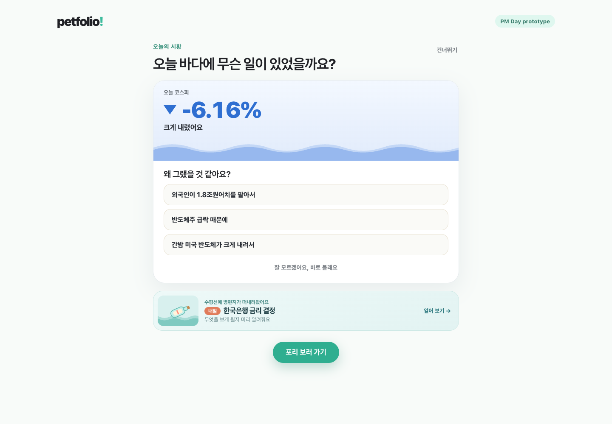
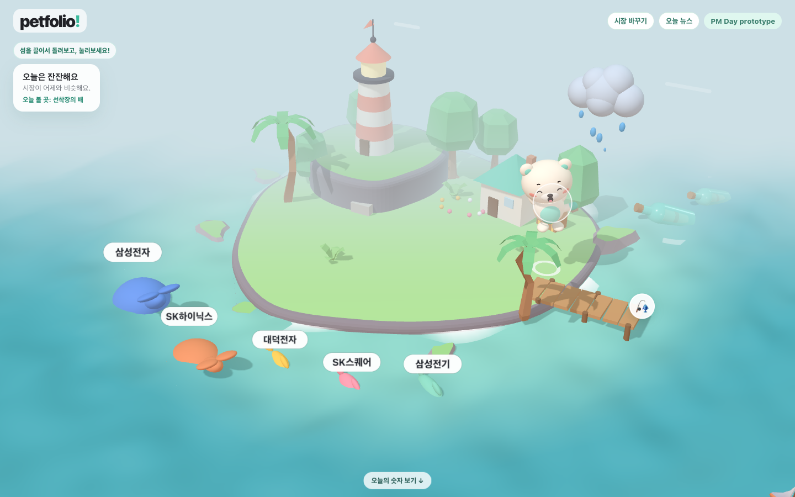
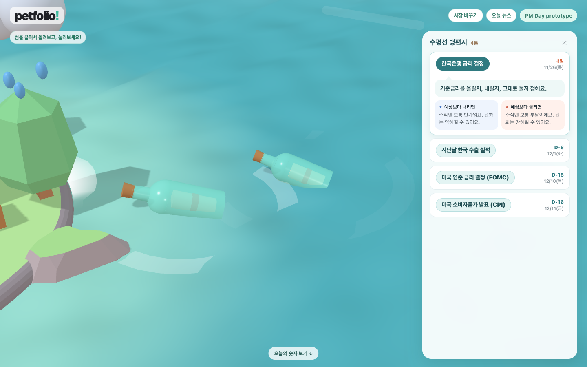
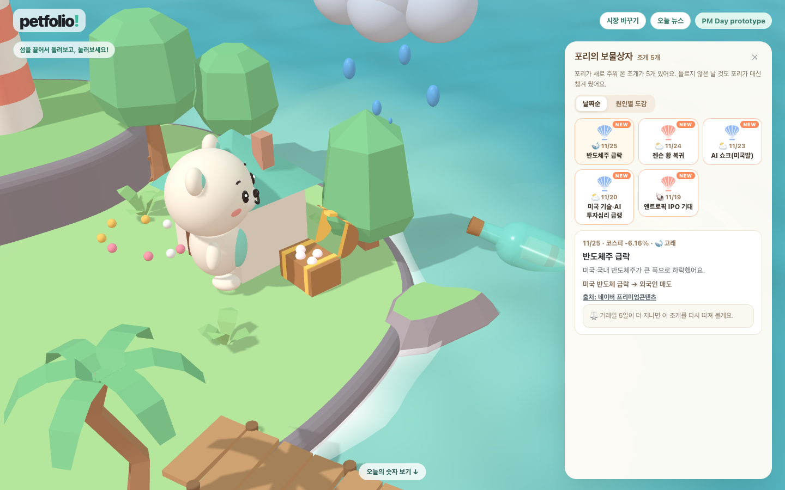
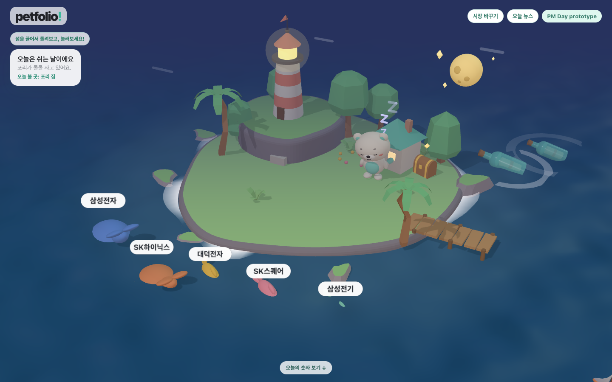
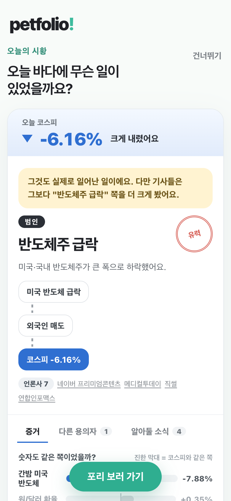
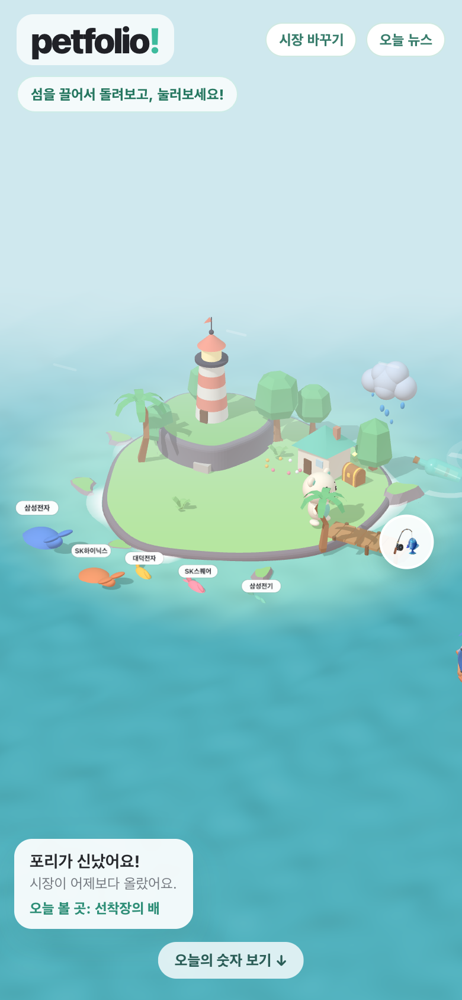

<div align="center">


# petfolio!

**포리가 당신 대신 시장이라는 바다를 지켜봐요.**<br />
들르면 오늘 무슨 일이 있었는지, 왜 그랬는지 30초로 들려줘요.

<p>
  
  
  
  
  
  
</p>

</div>

<br />

## 왜 만들었나

시장에 관심은 있지만, 시황 기사를 읽을 시간도 차트를 들여다볼 여유도 없는 사람이 많아요. 증권 앱은 이미 투자하는 사람을 위한 화면이고, 시황 기사는 용어가 어렵습니다.

**petfolio!** 는 하루 시장을 수달 **포리**가 사는 작은 섬의 풍경으로 바꿔 보여줘요. 숫자 대신 날씨와 물과 배를 보면, 오늘 시장이 어땠는지 그리고 **왜** 그랬는지가 한눈에 들어옵니다.

> 시장에 관심은 있지만 시간을 들이고 싶지 않은 사람이, 하루 30초로 오늘 시장이 왜 움직였는지 알게 한다.

<br />

## 미리보기

<table>
  <tr>
    <td width="50%"></td>
    <td width="50%"></td>
  </tr>
  <tr>
    <td align="center"><b>먼저 맞혀 보기</b><br /><sub>오늘 결과를 보고, 왜 그랬을지 문장 셋 중에 골라요</sub></td>
    <td align="center"><b>오늘의 범인</b><br /><sub>확신도 도장, 원인 흐름, 숫자 증거가 카드 한 장에</sub></td>
  </tr>
  <tr>
    <td></td>
    <td></td>
  </tr>
  <tr>
    <td align="center"><b>포리의 섬</b><br /><sub>포리는 섬을 돌아다니고, 끌면 들어 옮길 수 있어요</sub></td>
    <td align="center"><b>수평선 병편지</b><br /><sub>다가오는 일정과 "예상보다 높으면 / 낮으면"</sub></td>
  </tr>
  <tr>
    <td></td>
    <td></td>
  </tr>
  <tr>
    <td align="center"><b>보물상자</b><br /><sub>들르지 않은 날 것까지 조개로 쌓이고, 일주일 뒤 재판이 열려요</sub></td>
    <td align="center"><b>낚시</b><br /><sub>화제 종목을 낚아 평소 대비 출렁임과 기대·우려를 봐요</sub></td>
  </tr>
  <tr>
    <td></td>
    <td>
      
      
    </td>
  </tr>
  <tr>
    <td align="center"><b>휴장일 밤</b><br /><sub>등대와 창문에 불이 켜지고 포리는 쿨쿨</sub></td>
    <td align="center"><b>폰에서도</b><br /><sub>웹앱(PWA)으로 갈 예정이에요</sub></td>
  </tr>
</table>

<br />

## 섬을 읽는 법

섬의 모든 것은 실제 시장 데이터와 이어져 있어요. 배우지 않아도 읽히도록, 바다에서 일어날 법한 일에 맞췄습니다.

| 섬에서 | 시장에서 | 이렇게 바뀌어요 |
|---|---|---|
| 🦦 포리의 표정 | 코스피 등락 | 오르면 깡충깡충, 내리면 시무룩, 휴장일엔 쿨쿨 |
| 🌊 밀물과 썰물 | 거래대금 | 거래가 많을수록 물이 차올라 모래사장이 잠겨요 |
| 〰️ 바깥 바다의 파도 | 변동성 (하루 고가−저가) | 출렁인 날일수록 파도가 거세요 |
| ⛵ 산호색 돛 · 바다사자 선장 | 외국인 순매수 | 사면 화물을 싣고 정박해 손을 흔들고, 팔면 등을 돌려 떠나요 |
| ⛵ 파란 돛 · 정장 펭귄 | 기관 순매수 | 〃 |
| ⛅ 외해의 날씨 | 간밤 미국 증시 | 맑음 · 구름 · 비. 날씨는 맑은데 포리가 운다면 "미국 탓이 아닌 날" |
| 🚩 등대 깃발과 바람 | 원/달러 환율 | 환율이 오르면 외국인 배가 떠나는 쪽으로 바람이 불어요 |
| 🐋 고래 두 마리 | 삼성전자 · SK하이닉스 | 오르면 물을 뿜으며 뛰어오르고, 내리면 가라앉아요 |
| 🐟 이름표 물고기 | 오늘의 화제 종목 3개 | 거래대금 상위 종목 중 가장 크게 움직인 녀석들 (매일 바뀜) |
| 🍾 수평선의 병 | 다가오는 일정 | 금리 결정·물가·수출 발표가 가까워질수록 섬으로 다가와요 |
| 🌫️ 안개 | 뚜렷한 범인이 없는 날 | 억지로 이유를 붙이지 않아요 |
| 🐚 보물상자의 조개 | 그날의 범인 | 장이 열린 날마다 하나씩 저절로 쌓여요 |

처음 온 사람에겐 포리, 물, 파도, 날씨만 보여요. 배, 고래, 바람, 병편지는 **실제 시장에서 그것이 중요했던 날** 처음 나타나요(늦어도 2~6번째 방문). 한 번에 너무 많이 배우지 않도록 하루 두 가지까지만 열려요.

<br />

## 하루의 흐름

```
 시장 고르기  ──▶  오늘의 시황  ──(구름 속으로)──▶  포리의 섬
 (처음 한 번)      (그날 처음 한 번)                   (언제든)
                  ├ 결과 보고 범인 맞히기             ├ 눌러서 알아보기: 날씨 · 배 · 고래 · 물고기
                  ├ 범인 · 확신도 · 원인 흐름          ├ 포리 들어 옮기기
                  └ 탭: 증거 · 다른 용의자 · 소식      ├ 🎣 낚시: 화제 종목 하나 낚기
                                                    ├ 🍾 병편지: 다가오는 일정
                                                    └ 🐚 보물상자: 원인별 도감 · 일주일 뒤 재판
```

- 매일 할 일은 없어요. 들르지 않은 날의 조개도 포리가 대신 주워 둬요.
- 맞히기에는 점수도 기록도 없어요. 틀려도 "그것도 실제로 일어난 일이에요. 다만 기사들은…"처럼 배울 거리만 남겨요.

<br />

## "오늘의 범인"은 이렇게 찾아요

숫자만 보면 **무엇이** 움직였는지는 알아도 **왜**인지는 몰라요. 그래서 원인은 기사와 증권사 리포트에서 찾고, 숫자는 검증에만 씁니다.

```
 장 마감(15:50) 뒤
 언론사 마감 기사 제목 50~60건  ┐
 증권사 장 마감 시황 리포트 제목 ┴─▶  LLM이 공통으로 지목된 원인 하나를 고름
                                    · 제목에 없는 내용은 쓰지 않기
                                    · 언론사·증권사 2곳 이상이 말해야 인정
                                    · 뚜렷한 원인이 없으면 "안개 낀 날"
                                    · 형식 고정: 이름 6~14자, 설명 한 문장, 흐름 2단계
                                         │
 미국 증시 · 환율 · 수급 · 대장주 숫자  ─▶  확신도(유력 / 가능성 있음 / 불확실) + 숫자 증거
                                         │
 다음 날 아침 증권사 리포트             ─▶  증권사 확인 도장 (같음 / 일부 같음 / 다르게 봄)
 거래일 5일 뒤 기록과 기사              ─▶  일주일 뒤 재판 (설명 유지 / 일부 수정 / 판단 보류)
```

정해진 후보(예: 미국 증시)만 바라보면 다른 원인이 있는 날에도 그 후보를 범인으로 고르게 돼요. 기사에서 출발하면 "젠슨 황 해임설"처럼 숫자로는 찾을 수 없는 원인도 잡힙니다. 장 마감 전과 쉬는 날에는 지난 거래일 이야기를 보여줘요.

<br />

## 기술 스택

| 영역 | 사용한 것 |
|---|---|
| 화면 | **React 19**, **Vite 8**, 순수 CSS |
| 3D | **Three.js r170** (React Three Fiber 없이 직접 렌더링). 포리·고래·선원은 코드로 빚은 클레이 모델, 나무·바위·배는 Kenney CC0 모델을 섬 색으로 다시 칠해 사용 |
| 애니메이션 | 한 번의 `requestAnimationFrame` 루프에서 모든 움직임을 계산하고 감쇠(damp)로 부드럽게. 화면 전환·카드·막대는 CSS 애니메이션 |
| 서버 | Vite 개발 서버 미들웨어 + **Vercel Serverless Functions** (`api/`) |
| 기록 | 날짜별 시장 기록: 로컬은 파일, 배포는 **Upstash Redis** |
| AI | **OpenAI** (`gpt-5-mini`, JSON 스키마 출력). 범인 고르기, 증권사 확인, 재판, 일정 예상(값만 고르고 문장은 틀로) |
| 데이터 | Yahoo Finance, 네이버 금융(수급·화제 종목·일별 지수·증권사 시황 리포트 제목), Google 뉴스·연합뉴스 RSS |
| 품질 | oxlint, `prefers-reduced-motion` 대응, 모바일 레이아웃 |

<br />

## 프로젝트 구조

```
src/
├─ App.jsx               화면 전환, 데이터 불러오기, 설명 카드·낚시·구름 전환
├─ PoriIsland.jsx        포리의 섬 (산책, 들어 옮기기, 병, 안개)
├─ Pori3D.jsx            포리·배·고래·물고기·날씨 부품
├─ ShellChest.jsx        보물상자 (도감, 재판, 증권사 확인 도장)
├─ LetterPanel.jsx       수평선 병편지
├─ screens/              시장 고르기, 오늘의 시황(사건 카드)
└─ domain/               시장·뉴스·조개·섬 열리기 규칙
server/
├─ kospi.js · drivers.js · movers.js   지수·수급·미국 증시·환율·화제 종목
├─ news.js · reports.js                마감 기사 제목, 증권사 시황 리포트 제목
├─ briefing.js                         오늘의 범인
├─ records.js · replay.js              날짜별 기록, 지난 거래일 다시 만들기
├─ trial.js · brokerCheck.js           일주일 뒤 재판, 증권사 확인 도장
├─ letters.js                          수평선 병편지 (공식 일정)
└─ stockNews.js                        낚시 종목 소식
api/                     위 서버 코드를 감싼 Vercel 함수
```

데이터와 장면의 세부 규칙은 [docs/DEVELOPMENT.md](docs/DEVELOPMENT.md)에 정리했어요.

<br />

## 실행하기

```bash
npm install
npm run dev
```

`http://localhost:5173` 에서 열려요. 오늘의 범인을 만들려면 프로젝트 폴더의 `.env.local`에 OpenAI 키를 넣어주세요. 키가 없어도 앱은 돌아가고, 범인 대신 숫자 요약이 나옵니다.

```bash
OPENAI_API_KEY=...
```

지난 거래일 기록을 채우려면 `npm run backfill -- 20`.

### 발표·캡처용 주소

| 주소 | 하는 일 |
|---|---|
| `?screen=select` · `news` · `scene` | 처음 보여줄 화면 |
| `?demo=rise` · `flat` · `fall` · `closed` | 시장 상태 고정 (휴장일 시연용) |
| `?open=fishing` · `chest` · `bottles` · `samsung` … | 섬이 뜨고 잠시 뒤 그 대상을 연 상태로 |
| `?island=all` · `new` | 다 열린 섬 / 처음 온 사람의 섬 (저장 안 함) |

예: `http://localhost:5173/?screen=scene&demo=rise&island=all`

<br />

## 다음 단계

- **웹앱(PWA)**: 홈 화면 설치, 마감 알림 하루 한 번, 아이콘에 새 조개 숫자
- **포리에게 관심 분야 입히기**: 관심 분야 소품을 걸치고, 그 분야가 움직인 날 먼저 알려주기
- **친구 섬 방문**, **포리와 대화**
- **다른 시장 캐릭터**: 미장은 하늘, 크립토는 우주

<br />

## 출처와 고지

- 3D 모델: [Kenney](https://kenney.nl) Nature Kit · Pirate Kit (CC0). 자세한 내용은 [public/models/island/CREDITS.txt](public/models/island/CREDITS.txt)
- 시세·수급·뉴스·증권사 리포트 제목은 공개 페이지와 RSS의 비공식 경로로 가져오는 프로토타입용 데이터예요. 서비스로 낼 때는 정식 데이터 계약과 약관 확인이 필요합니다.
- 기사와 리포트는 제목·출처·링크만 보여주고 본문은 가져오지 않아요.
- 일정 날짜는 한국은행·미국 연준·미국 노동통계국의 공식 일정이에요.
- **petfolio! 는 투자 조언이나 종목 추천을 하지 않아요.** 포리는 시장이 어땠는지 보여줄 뿐, 고르는 건 언제나 당신의 몫이에요.

<br />

<div align="center">
<sub>UMC 11기 아홀로틀 지부 PM Day 프로토타입</sub>
</div>
