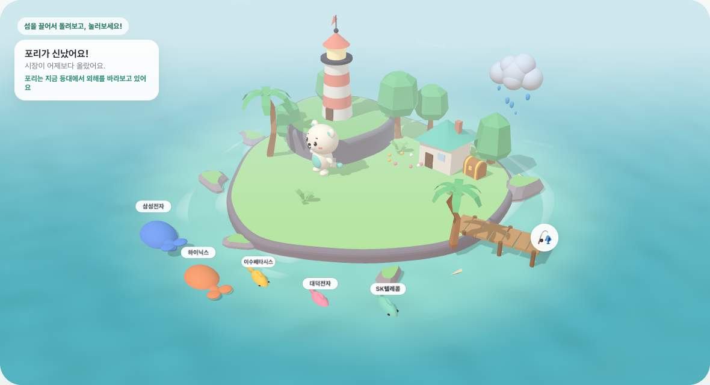
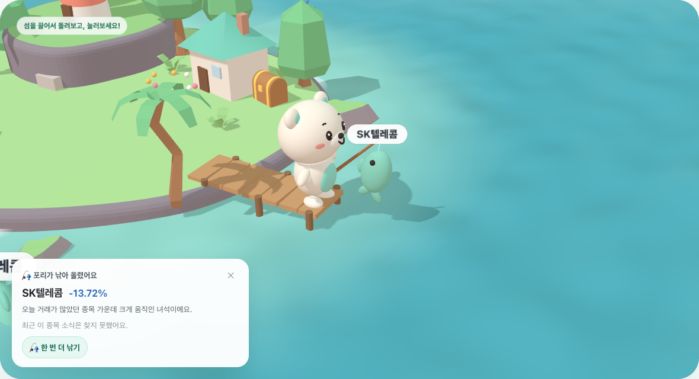
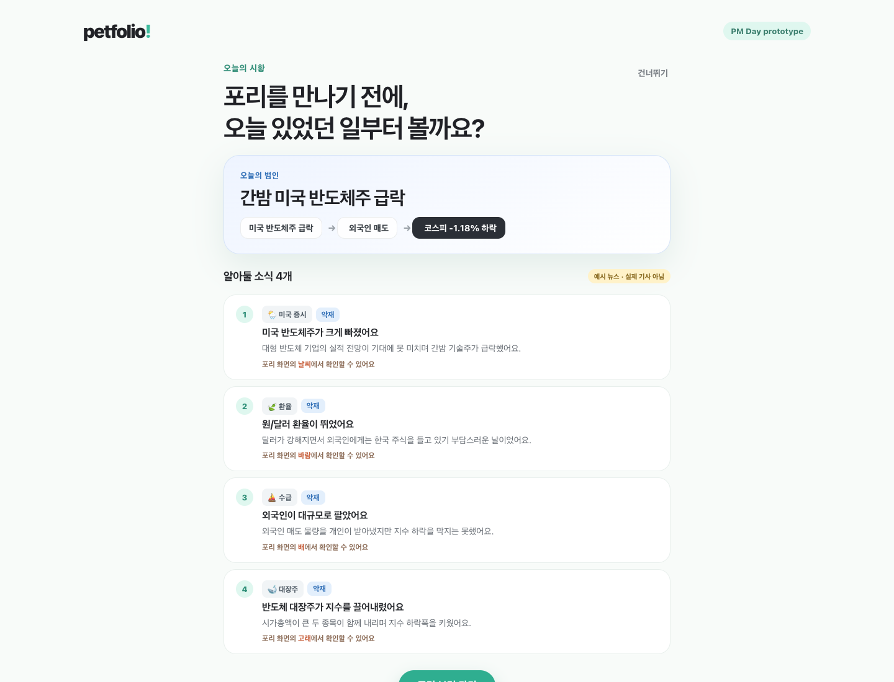
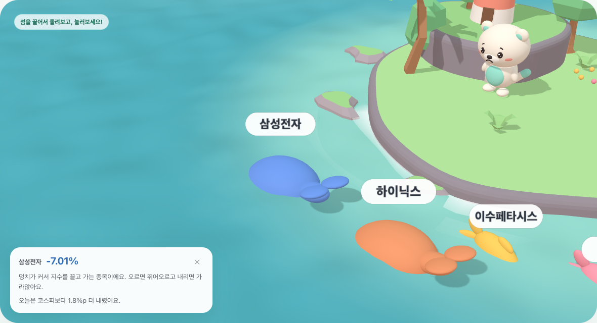

<div align="center">



# petfolio!

**포리가 당신 대신 시장이라는 바다를 지켜봐요.**<br />
들르면 오늘 무슨 일이 있었는지 30초로 들려줘요.

<p>
  
  
  
  
  
  
</p>

</div>

<br />

## 왜 만들었나

시장에 관심은 있지만, 시황 기사를 읽을 시간도 차트를 들여다볼 여유도 없는 사람이 많아요. 증권 앱은 이미 투자하는 사람을 위한 화면이고, 시황 기사는 용어가 어렵습니다.

**petfolio!** 는 하루 시장을 수달 **포리**가 사는 작은 섬의 풍경으로 바꿔 보여줘요. 숫자 대신 날씨와 물과 배를 보면, 오늘 시장이 어땠는지 그리고 **왜** 그랬는지가 한눈에 들어옵니다.

> 시장에 관심은 있지만 시간을 들이고 싶지 않은 사람이, 하루 30초로 오늘 시장이 왜 움직였는지 알게 한다.

<br />

## 미리보기

<table>
  <tr>
    <td width="50%"></td>
    <td width="50%"></td>
  </tr>
  <tr>
    <td align="center"><b>장이 열린 날</b><br /><sub>포리가 오늘 이야기가 있는 곳으로 걸어가요</sub></td>
    <td align="center"><b>휴장일 밤</b><br /><sub>등대와 창문에 불이 켜지고 포리는 쿨쿨</sub></td>
  </tr>
  <tr>
    <td></td>
    <td></td>
  </tr>
  <tr>
    <td align="center"><b>낚시</b><br /><sub>오늘의 화제 종목을 낚아 올리고 그 종목 소식을 봐요</sub></td>
    <td align="center"><b>보물상자</b><br /><sub>장이 열린 날마다 그날의 이야기가 조개로 쌓여요</sub></td>
  </tr>
  <tr>
    <td></td>
    <td></td>
  </tr>
  <tr>
    <td align="center"><b>오늘의 범인</b><br /><sub>기사 제목들에서 오늘 시장을 움직인 원인을 찾아요</sub></td>
    <td align="center"><b>눌러서 알아보기</b><br /><sub>고래, 배, 날씨를 누르면 숫자와 의미, 관련 뉴스가 떠요</sub></td>
  </tr>
</table>

<br />

## 섬을 읽는 법

섬의 모든 것은 실제 시장 데이터와 이어져 있어요. 배우지 않아도 읽히도록, 바다에서 일어날 법한 일에 맞췄습니다.

| 섬에서 | 시장에서 | 이렇게 바뀌어요 |
|---|---|---|
| 🦦 포리의 표정 | 코스피 등락 | 오르면 깡충깡충, 내리면 시무룩, 휴장일엔 쿨쿨 |
| 🌊 밀물과 썰물 | 거래대금 | 거래가 많을수록 물이 차올라 모래사장이 잠겨요 |
| 〰️ 바깥 바다의 파도 | 변동성 (하루 고가−저가) | 출렁인 날일수록 파도가 거세요 |
| ⛵ 산호색 돛 · 바다사자 선장 | 외국인 순매수 | 사면 화물을 싣고 정박해 손을 흔들고, 팔면 등을 돌려 떠나요 |
| ⛵ 파란 돛 · 정장 펭귄 | 기관 순매수 | 〃 |
| ⛅ 외해의 날씨 | 간밤 미국 증시 (나스닥) | 맑음 · 구름 · 비. 날씨는 맑은데 포리가 운다면 "미국 탓이 아닌 날" |
| 🚩 등대 깃발과 바람 | 원/달러 환율 | 환율이 오르면 외국인 배가 떠나는 쪽으로 바람이 불어요 |
| 🐋 고래 두 마리 | 삼성전자 · SK하이닉스 | 오르면 물을 뿜으며 뛰어오르고, 내리면 고개를 숙이고 가라앉아요 |
| 🐟 이름표 물고기 | 오늘의 화제 종목 3개 | 거래대금 상위 종목 중 가장 크게 움직인 녀석들 |
| 🐚 보물상자의 조개 | 그날의 범인 | 장이 열린 날마다 하나씩 저절로 쌓여요 |

포리는 그날의 범인이 있는 장소로 알아서 걸어가 있어요. 외국인이 크게 판 날엔 선착장에서 떠나는 배를, 간밤 미국이 흔들린 날엔 등대에서 외해를 보고 있습니다.

<br />

## 하루의 흐름

```
 시장 고르기  ──▶  오늘의 범인  ──▶  포리의 섬
 (처음 한 번)      (그날 처음 한 번)     (언제든)
                                         ├─ 눌러서 알아보기: 날씨 · 배 · 고래 · 물고기
                                         ├─ 🎣 낚시: 화제 종목 하나를 낚아 그 소식 보기
                                         └─ 🐚 보물상자: 지난 날들의 조개 다시 보기
```

- **시장 고르기**: 캐릭터 카드를 좌우로 돌려 골라요. 지금은 국장(포리)만 열려 있고, 미장과 크립토는 준비 중이에요.
- **오늘의 범인**: 그날 처음 들어올 때만 뜨고 건너뛸 수 있어요.
- 매일 할 일은 없어요. 조개는 저절로 쌓이고, 들르고 싶을 때 들르면 됩니다.

<br />

## "오늘의 범인"은 이렇게 찾아요

숫자만 보면 **무엇이** 움직였는지는 알아도 **왜**인지는 몰라요. 그래서 원인은 기사에서 찾고, 숫자는 검증에만 씁니다.

```
 언론사 마감 기사 제목 50~60건  ─▶  LLM이 공통으로 지목된 원인 하나를 고름
                                    · 제목에 없는 내용은 쓰지 않기
                                    · 언론사 2곳 이상이 말해야 인정
                                    · 뚜렷한 원인이 없으면 "조용한 날"
                                         │
 미국 증시 · 환율 · 수급 · 대장주 숫자  ─▶  그 설명을 숫자가 뒷받침하는지 표시
```

정해진 후보(예: 미국 증시)만 바라보면 다른 원인이 있는 날에도 그 후보를 범인으로 고르게 돼요. 기사에서 출발하면 "젠슨 황 해임설"이나 "D램 담합 소송"처럼 숫자로는 절대 찾을 수 없는 원인도 잡힙니다. 장 마감 뒤 만든 결과는 그날 내내 고정돼서, 볼 때마다 설명이 바뀌지 않아요.

<br />

## 기술 스택

| 영역 | 사용한 것 |
|---|---|
| 화면 | **React 19**, **Vite 8**, 순수 CSS |
| 3D | **Three.js r170** (React Three Fiber 없이 직접 렌더링). 포리·고래·배 선원은 코드로 빚은 클레이 모델, 나무·바위·배는 Kenney CC0 모델을 섬 색으로 다시 칠해 사용 |
| 애니메이션 | 한 번의 `requestAnimationFrame` 루프에서 모든 움직임을 계산. 상태가 바뀌면 값이 부드럽게 따라가도록 감쇠(damp) 처리 |
| 서버 | Vite 개발 서버 미들웨어 + **Vercel Serverless Functions** (`api/`) |
| AI | **OpenAI** (`gpt-5-mini`, JSON 스키마 출력)로 기사 제목에서 범인과 소식 고르기 |
| 데이터 | Yahoo Finance (지수·환율·종목), 네이버 금융 (수급·거래대금·화제 종목), Google 뉴스 RSS·연합뉴스 RSS (기사 제목) |
| 품질 | oxlint, `prefers-reduced-motion` 대응, 모바일 레이아웃 |

<br />

## 프로젝트 구조

```
src/
├─ App.jsx               화면 전환, 데이터 불러오기, 설명 카드·낚시·보물상자
├─ PoriIsland.jsx        포리의 섬 (기본 장면)
├─ Pori3D.jsx            포리·배·고래·물고기·날씨 부품, 예전 단면 장면
├─ ShellChest.jsx        보물상자 화면
├─ screens/              시장 고르기, 오늘의 범인
└─ domain/               시장·뉴스·조개 데이터 규칙
server/
├─ kospi.js              지수·수급·거래대금·변동성
├─ drivers.js            간밤 미국 증시·환율·대장주
├─ movers.js             오늘의 화제 종목
├─ news.js               마감 기사 제목 수집
├─ briefing.js           오늘의 범인 (LLM + 숫자 검증)
└─ stockNews.js          종목별 최근 기사 (낚시)
api/                     위 서버 코드를 감싼 Vercel 함수
public/models/island/    섬에 쓴 3D 모델과 출처
```

데이터와 장면의 세부 규칙은 [docs/DEVELOPMENT.md](docs/DEVELOPMENT.md)에 정리했어요.

<br />

## 실행하기

```bash
npm install
npm run dev
```

`http://localhost:5173` 에서 열려요. 오늘의 범인을 만들려면 프로젝트 폴더에 `.env.local`을 만들고 OpenAI 키를 넣어주세요. 키가 없어도 앱은 돌아가고, 범인 대신 숫자 요약과 기사 제목 목록이 나옵니다.

```bash
OPENAI_API_KEY=...
```

### 발표·캡처용 주소

주소 뒤에 붙여서 화면과 상황을 고정할 수 있어요. 휴장일에 시연할 때 유용합니다.

| 주소 | 하는 일 |
|---|---|
| `?screen=select` · `news` · `scene` | 처음 보여줄 화면 |
| `?demo=rise` · `flat` · `fall` · `closed` | 시장 상태 고정 (수급·원인·화제 종목은 실제 데이터) |
| `?open=fishing` · `chest` · `samsung` … | 섬이 뜨고 잠시 뒤 그 대상을 누른 상태로 |
| `?scene=sea` | 섬 이전의 단면 장면 |

예: `http://localhost:5173/?screen=scene&demo=rise&open=fishing`

<br />

## 다음 단계

- **포리에게 관심 종목 입히기**: 관심 분야를 고르면 포리가 그 분야 소품을 걸치고, 그 종목이 움직인 날엔 먼저 말을 걸어요
- **친구 섬 방문**: 서로의 섬과 보물상자 구경하기
- **포리와 대화**: 그날의 범인을 바탕으로 포리 말투로 묻고 답하기
- **병 속 편지**: 실적 발표·금리 결정 같은 다가오는 일정이 수평선에서 떠내려와요
- **다른 시장 캐릭터**: 미장은 하늘, 크립토는 우주

<br />

## 출처와 고지

- 3D 모델: [Kenney](https://kenney.nl) Nature Kit · Pirate Kit (CC0). 자세한 내용은 [public/models/island/CREDITS.txt](public/models/island/CREDITS.txt)
- 시세·수급·뉴스는 공개 페이지와 RSS의 비공식 경로로 가져오는 프로토타입용 데이터예요. 서비스로 낼 때는 정식 데이터 제공 계약이 필요합니다.
- 기사는 제목·언론사·링크만 보여주고 본문은 가져오지 않아요.
- **petfolio! 는 투자 조언이나 종목 추천을 하지 않아요.** 포리는 시장이 어땠는지 보여줄 뿐, 고르는 건 언제나 당신의 몫이에요.

<br />

<div align="center">
<sub>UMC 11기 아홀로틀 지부 PM Day 프로토타입</sub>
</div>
